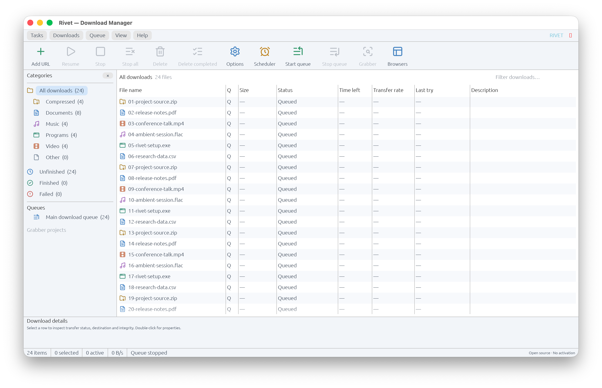

# Rivet


**An open-source desktop download manager for Windows, macOS, and Linux.**

Rivet helps you organize HTTP/HTTPS downloads, use multiple connections, pause and resume supported transfers, and send download links from your browser. It includes a desktop application, command-line tools, and Chromium/Firefox extensions.

[](https://github.com/Mfuon2/rivet/actions/workflows/release.yml)

[Downloads](https://github.com/Mfuon2/rivet/releases) · [Browser setup](docs/BROWSER.md) · [Roadmap](docs/ROADMAP.md) · [Security](SECURITY.md)



## Features

- HTTP/HTTPS downloads with up to 16 concurrent range connections.
- Pause and resume when the server provides range support and a strong ETag.
- SHA-256 verification, with an optional expected checksum.
- Persistent queue and download history, one-time scheduling, and batch actions.
- Compact desktop interface with categories, live progress, sortable/resizable columns, and light/dark themes.
- Click an active download to open live segment progress, byte ranges, pause and resume controls.
- Chrome, Edge, Chromium, and Firefox link handoff through a local native helper.
- Optional media-link discovery and an in-page download widget for sites you explicitly enable.
- CLI support for downloads, queue management, and HTTP/SOCKS proxy settings.

Rivet has no activation, subscription gate, advertising, or telemetry.

## Download and install

Download the package matching your operating system and processor from [GitHub Releases](https://github.com/Mfuon2/rivet/releases).

| Platform | Packages |
| --- | --- |
| Windows | Setup EXE or ZIP archive |
| macOS | PKG installer or application archive |
| Linux | DEB package or tarball |

**Preview release:** some features and platform integrations are still in development. Linux packages are built on Ubuntu 24.04. Windows installers do not have Authenticode publisher signatures; macOS packages are not Developer ID-signed or notarized, so platform warnings may appear.

Release checksums are signed with Minisign. Follow the [verification instructions](release/VERIFYING.md) before installing. The public verification key is in [release/minisign.pub](release/minisign.pub).

## Getting started

1. Install and open Rivet.
2. Follow the default-browser setup screen, or continue to the download manager.
3. Choose **Add URL**, enter a download address and destination filename, then add it to the queue.
4. Select the entry and choose **Resume**, or choose **Start queue** to process queued downloads.

Automatic queue processing is off at startup. **Stop** pauses selected active transfers; **Stop all** stops queue processing and pauses active transfers. Completed destination files are never overwritten.

## Browser integration

On startup, Rivet detects a supported default browser, prepares the extension files, and registers its native helper for the current user. Open **Browsers** in the toolbar to check or repeat setup.

Setup checks whether the extension is present, prepares the native connection, opens an available store installation page, and confirms the connection automatically after browser approval. You can continue or restart Rivet once setup completes.

While store approval is pending, setup offers the matching GitHub ZIP, the already-prepared extension folder and the browser installer page. Chrome/Edge/Chromium use **Developer mode → Load unpacked**; Firefox uses **Load Temporary Add-on**, which must be repeated after Firefox restarts. Rivet does not bypass browser approval.

The extension connects automatically after installation; its **Finish setup** page and **Check connection** button are available for troubleshooting. Right-click a download link and select **Send link to Rivet**. Captured links appear in the desktop queue.

See [browser setup](docs/BROWSER.md) for detailed instructions and troubleshooting.

## Build from source

Requirements: Rust 1.95 or newer, Python 3.11 or newer for packaging scripts, CMake, and a C/C++ toolchain. Windows builds need Visual Studio C++ Build Tools. Linux desktop builds also need the development libraries listed in [the CI workflow](.github/workflows/ci.yml).

```sh
git clone https://github.com/Mfuon2/rivet.git
cd rivet
cargo build --workspace --locked
cargo run -p rivet-desktop
```

Build optimized executables and a native package on the target OS:

```sh
cargo build --release --workspace --locked
python3 scripts/release.py package --installer
```

Installer packaging requires Inno Setup 6 on Windows, `pkgbuild` on macOS, or `dpkg-deb` on Debian/Ubuntu. See the [release guide](release/README.md) for maintainer packaging and signing instructions.

## Command-line usage

Download a file:

```sh
cargo run -p rivet-cli --bin rivet -- get 'https://example.com/file.zip' -o /absolute/path/file.zip -c 4
```

Add a queued job and process due jobs:

```sh
cargo run -p rivet-cli --bin rivet -- add 'https://example.com/file.zip' -o /absolute/path/file.zip
cargo run -p rivet-cli --bin rivet -- run
```

Use `--help` for available commands. `--database` selects a queue database; `--proxy` configures a CLI proxy. `RIVET_DATABASE` and `RIVET_DOWNLOAD_DIR` accept absolute paths for an alternate shared database and browser download directory.

## Current limitations

- Segmented resume requires a known size, byte-range support, and a strong ETag. Other resources restart after interruption.
- HLS/DASH assembly, session-cookie forwarding, automatic browser download takeover, FTP, site crawling, recurring schedules, and bandwidth budgets are not implemented.
- Safari is not supported yet.
- Destination filesystems must support hard links for final file publication.
- Local queues and resume metadata are not encrypted and may contain access tokens from download URLs.
- Automated builds/tests do not replace clean-machine installation and real-browser testing.

See [capabilities](docs/CAPABILITIES.md) and the [roadmap](docs/ROADMAP.md) for implementation status.

## Automatic releases

Updates merged into `main` automatically run the checks, build Windows/macOS/Linux packages, sign release checksums, publish a versioned GitHub release, and verify the uploaded downloads. Each release includes native installers, archives and browser ZIPs. See the [release guide](release/README.md) for versioning and recovery details.

## Development

```sh
cargo fmt --all -- --check
cargo clippy --workspace --all-targets --locked -- -D warnings
cargo test --workspace --locked
python3 -m unittest discover -s scripts/tests -v
node --test browser/tests/background.test.cjs
python3 scripts/smoke.py
```

The Rust application is in `crates/`, extension sources are in `browser/`, and packaging tools are in `scripts/` and `packaging/`. See [architecture](docs/ARCHITECTURE.md) for component details. Bug reports and pull requests are welcome through [GitHub](https://github.com/Mfuon2/rivet/issues).

## Privacy and security

Read the [privacy statement](PRIVACY.md) and [security design](SECURITY.md). Browser handoff does not forward cookies or passwords. Download requests go to the source servers selected by the user.

## License

Rivet is licensed under the [MIT License](LICENSE). Action and file icons use [Lucide](https://lucide.dev/) with the included [Lucide/Feather notices](crates/rivet-desktop/assets/lucide/LICENSE). The product logo is included in [assets/branding](assets/branding/).
