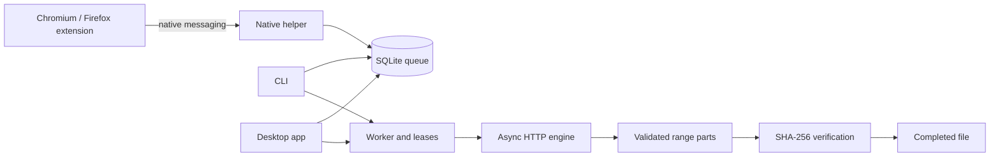

# Architecture

Rivet shares one download engine and persistent queue across its desktop application, CLI and browser helper.

## Components

- `rivet-core`: HTTP engine, range validation, queue persistence, worker ownership, native messaging and browser setup.
- `rivet-cli`: immediate downloads, queue commands, manifest generation and the dedicated `rivet-native-host` executable.
- `rivet-desktop`: native egui interface using the shared engine and queue.
- `browser/`: Chromium/Firefox extensions for explicit link handoff and optional direct-media discovery.
- `scripts/` and `packaging/`: browser packaging, platform installers, release signing and validation tools.

## Transfers and persistence

The engine uses pooled HTTP connections and bounded scheduling over preplanned ranges. Segmentation and resume require a known size, range support and a strong ETag. Responses are checked against requested offsets, total size, final URL and validator. A part reaches its full size only after the HTTP body ends cleanly.

Downloads use a work directory beside the destination. Per-output process locks prevent concurrent writers. Final publication verifies size and SHA-256, then creates a same-filesystem hard link without replacing an existing file.

SQLite stores queued jobs and history. Atomic ownership leases coordinate workers, refresh while a job runs, and expire after a worker stops unexpectedly. The CLI queue processes jobs sequentially; the desktop supports manual concurrent starts and sequential automatic processing.

## Browser connection

The browser launches the native helper using its registered manifest and enforces the extension allowlist. The helper accepts bounded JSON messages containing a download URL or a connection ping. URLs enter the queue; they do not execute downloaded files. No local HTTP/WebSocket bridge is exposed.

First-launch setup detects a supported default browser, prepares embedded extension assets and registers the sibling helper for the current user. Extension installation and permissions remain controlled by the browser. Successful exchanges record the extension ID and time locally for setup diagnostics.

## Further development

See [capabilities](CAPABILITIES.md), the [roadmap](ROADMAP.md), and [SECURITY.md](../SECURITY.md) for current limitations and planned improvements.
