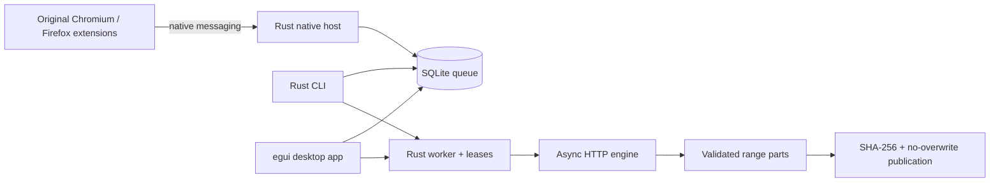

# Architecture and delivery stages

## Product constraints

Windows, macOS and Linux are first-class targets from the start. The project is MIT open source with no activation or license-key service. Core transfers, queue persistence, UI and browser IPC are owned by Rivet. The architecture permits platform adapters without coupling downloads to a privileged driver.

`rivet-core` owns the engine, queue, native protocol and worker lifecycle. `rivet-cli` provides immediate transfers, automation, queue operations and a dedicated native-host executable. `rivet-desktop` uses the same engine/queue with an egui frontend. Browser code is original JavaScript because browsers require WebExtension APIs; download logic stays in Rust.

The UI and CLI independently claim jobs with atomic SQLite updates. Leases expire after 30 seconds and refresh every five seconds. Per-output OS locks provide a second guard against duplicate writes. This initial worker processes the CLI queue serially; each download can use multiple connections. The desktop permits manual concurrent starts and sequential automatic processing. Configurable global/per-host concurrency budgets are a later stage.

## Stages

1. **Working foundation (implemented; local validation in progress/completed as documented in VALIDATION.md):** range engine, conservative resume, hashes, cancellation, durable queue, delayed CLI jobs, desktop UI, browser URL/native handoff, opt-in direct-media discovery, CI matrix.
2. **Download reliability and desktop completion:** transfer checkpoints and per-part hashes; per-host/global concurrency; fair bandwidth limits; retry policy honoring Retry-After; recurring schedules/time zones; category rules; import/export; tray and notifications; file dialogs; accessible keyboard flows; translated UI; crash recovery UX; batch actions; disk-space budgets.
3. **Browser and media:** OS-keychain-backed per-origin credentials; narrowly scoped, opt-in cookie/header transfer; origin/redirect-aware secret stripping; direct browser download interception; HLS VOD/live and DASH parsing; variant/audio/subtitle selection; resumable media segments; optional external FFmpeg remuxing with explicit dependency/progress handling. No claim of DRM support.
4. **Protocol and advanced workflow parity:** FTP/FTPS; HTTP Basic/Digest and site login profiles; explicit/PAC/system proxies; site grabbing with depth/domain/robots rules; synchronization; ZIP inspection; antivirus integration; launch-after-completion and power actions as explicit opt-ins.
5. **OS integration and release quality:** per-user native-host registration installers for supported browsers; context menus and URL handlers; signed Windows installer/macOS application bundle and Linux packages; updater signature verification; SBOM/dependency audit; fuzz/property/soak tests; accessibility checks and performance benchmarks on all three OSes.
6. **Optional deep interception adapters:** investigate whether browser APIs cover the needed behavior first. If a Windows WFP driver is justified, implement and validate it separately with its own privilege, signing and upgrade lifecycle. macOS/Linux mechanisms differ and require independent designs and evidence. No driver is installed or implemented in the foundation.

## Evidence and parity

The REA reports outside this project document observed HTTP-range/proxy/TLS code, browser/native-host handoff, and Windows driver interfaces. Additional installer language resource declarations mention queues, scheduling, categories, FTP, logins, ZIP preview, antivirus hooks and grabbing. These declarations are requirements candidates, not proofs of every internal behavior. The capability matrix separates implementation from evidence.

Original binary execution remains outside this implementation workflow. We test Rivet against independent local fixtures and original test data. Any future runtime comparison of the original application would require separate user authorization.

## Immediate next engineering milestone

Complete robust per-part integrity/checkpoint recovery and global bandwidth/concurrency limits, then authenticated browser handoff and HLS assembly. Maintain platform CI on every increment. Do not label any milestone full parity while matrix entries remain planned or partial.
